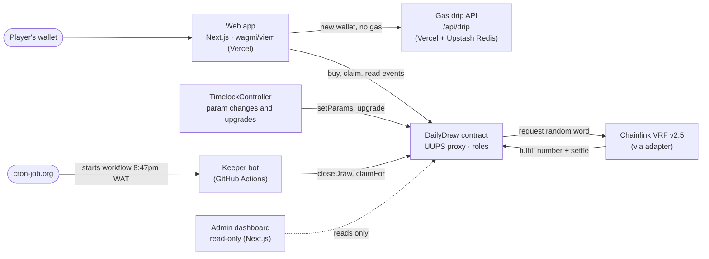

# Daily Draw

A daily pick-a-number draw (00–99) where anyone can check the randomness and the payouts
themselves. Players buy $1 tickets in USDC, sales close at 8:45pm WAT, a Chainlink VRF random
number picks the winner, and a smart contract splits the pool by fixed rules. I built it as a
portfolio project. It runs on the **Base Sepolia testnet with test USDC only**. It is a demo, not
an operating lottery, and it takes no real money.

- **Live app:** https://daily-draw-lake.vercel.app (connect a wallet on Base Sepolia; the app gives
  new wallets test ETH for gas and test USDC from a faucet)
- **Verify a draw:** https://daily-draw-lake.vercel.app/verify/1 (redoes draw #1 in your browser)
- **Contract (proxy, verified source):**
  [0x5f95…2ED9 on BaseScan](https://sepolia.basescan.org/address/0x5f953504743B7Da528A78A2CA4C3941cFda62ED9)
- **Incident write-up:** [the first draw closed late](docs/incidents/2026-11-25-keeper-missed-close.md)

## Status

I stopped plans to run it as a business on 2026-11-26 because of the harm gambling can do. The
testnet deployment stays up as a demo: a draw still runs every night with test money. There are no
real users, no revenue, and the contract has not been audited.

## Architecture



| Part                                                                      | What it does                                                                                                                                                                                                                                                                               |
| ------------------------------------------------------------------------- | ------------------------------------------------------------------------------------------------------------------------------------------------------------------------------------------------------------------------------------------------------------------------------------------ |
| [`DailyDraw.sol`](packages/contracts/src/DailyDraw.sol)                   | The game: one draw a day, tickets in bundles of 1/2/5/10, a 2% fee, a per-wallet limit, settlement and claims. Upgradeable (UUPS) behind an ERC-1967 proxy, with roles for admin, pauser, keeper, params and upgrader.                                                                     |
| Timelock                                                                  | OpenZeppelin `TimelockController`. It alone holds the params and upgrade roles, so every rule change waits (1 hour on the testnet, 48 hours as designed for a mainnet).                                                                                                                    |
| [VRF adapter](packages/contracts/src/randomness/ChainlinkVrfProvider.sol) | Asks Chainlink VRF v2.5 for one random word and passes it to the game, behind an `IRandomnessProvider` interface (a local `DevRandomness` stands in on Anvil).                                                                                                                             |
| [Web app](apps/web)                                                       | Next.js 16, wagmi 3, viem. Connect a wallet, get test USDC, pick numbers, watch the draw, claim, refer friends, verify any draw.                                                                                                                                                           |
| [Keeper](apps/keeper)                                                     | A TypeScript bot run by GitHub Actions ([workflow](.github/workflows/keeper.yml)). Closes the draw after the cutoff, and claims for winners who haven't claimed after 24 hours (the prize always goes to the winner). cron-job.org starts it on time; GitHub's own schedule is the backup. |
| [Gas drip](apps/web/app/api/drip/route.ts)                                | A Vercel function that sends a new wallet ~0.0005 test ETH so it can pay gas, with limits kept in Upstash Redis.                                                                                                                                                                           |
| [Admin dashboard](apps/admin)                                             | One read-only, password-protected page: tonight's draw, money held vs owed, keeper and VRF health, pending timelock changes. No buttons that move money.                                                                                                                                   |

## How a draw works

1. **Sales.** Players pick numbers from 00 to 99 and pay $1.02 a ticket ($1 to the pool, 2c fee).
   Each draw copies the game's settings when it opens, so a settings change never affects a draw
   already selling.
2. **Sales close** at 8:45pm WAT (19:45 UTC). The contract rejects tickets from then on.
3. **Close and request.** Anyone may call `closeDraw` after the cutoff; the keeper does it at
   8:47pm. The contract asks Chainlink VRF for a random word. Nobody, including the operator,
   knows or can choose it.
4. **Number and settlement.** Chainlink's coordinator checks the VRF proof on-chain and calls
   back. The contract computes `winning number = random word mod 100`
   ([`fulfillRandomness`](packages/contracts/src/DailyDraw.sol#L366)) and settles in the same
   transaction ([`_settle`](packages/contracts/src/DailyDraw.sol#L608)). The pool (sales plus any
   rollover) is split **65% to winning tickets, 20% to the winners' referrers and 15% to the
   project** (10% team, 5% buy-back reserve). If nobody picked the number, the whole pool rolls
   over to the next draw. Rounding dust also rolls over.
5. **Claims.** Settlement moves no tokens; it only records who is owed what. Winners `claim`
   when they like. After 24 hours the keeper may `claimFor` them, and the money still goes only to
   the winner. Unclaimed prizes roll back into the pool after 30 days.

If Chainlink never answers, the draw can be voided (by the admin, or by anyone after 24 hours)
and every ticket refunded in full, fee included.

### What the verify page checks

[`/verify/[id]`](apps/web/app/verify/[id]/page.tsx) redoes a settled draw in the browser from
public chain data only, read through a public RPC with no server of mine in between
([`lib/verify.ts`](apps/web/lib/verify.ts), pure functions, tested against a real Base Sepolia
fulfilment):

- **Randomness:** finds the VRF request and the Chainlink fulfilment transaction, decodes the
  proof, and checks that the proving key is the one requested, the proof answers this request
  (`requestId = keccak(keyHash, seed)`), and the delivered word is the proof's output
  (`keccak(outputSeed, 0)`). The elliptic-curve proof itself is checked on-chain by Chainlink's
  coordinator; the page doesn't redo that step.
- **Winning number:** `word mod 100` equals the number the contract stored.
- **Tickets and money:** recounts every ticket from `TicketsBought` events, rebuilds the pool and
  reruns the 65/20/10/5 split with the same TypeScript settlement code the contract is tested
  against, then compares each figure with the `DrawSettled` event.
- **Your tickets:** with a wallet connected, whether you won and how much.

Draw #1 passes all its checks: winning number 26, 159 tickets, 2 winning tickets.

## Engineering highlights

- **Invariant and fuzz tests on the money.** A Foundry handler plays random sequences of every
  action (buys, closes, late and duplicate VRF answers, claims, voids, refunds, sweeps, pauses,
  param changes, time jumps, stray tokens) and checks after every call that the contract's USDC
  equals exactly what it owes, that each ticket is paid at most once, and that no money moves
  outside the rules
  ([invariants](packages/contracts/test/invariant/DailyDraw.invariants.t.sol),
  [handler](packages/contracts/test/invariant/DailyDrawHandler.sol)). Unit tests reach 100% line
  and branch coverage on `DailyDraw.sol`, and a shared set of
  [test vectors](packages/shared/test-vectors/settlement.json) keeps the Solidity settlement and the
  TypeScript one (used by the verify page) identical.
- **Timelocked rule changes, used for real.** The fee went from 10% to 2% on the live testnet game
  through the timelock: scheduled, a 1-hour wait, then executed. The draw already open kept its
  10% price, and refunds for it stay exact
  ([`SetFee.s.sol`](packages/contracts/script/SetFee.s.sol), rehearsed on an Anvil fork first;
  steps in the [runbook](docs/testnet-runbook.md#changing-the-ticket-fee-10--2)).
- **Pull-based payouts.** The VRF callback only does arithmetic. It never transfers tokens, so a
  misconfigured treasury or a token that blocks an address can't make the callback revert (and
  Chainlink doesn't redeliver). Winners, referrers and the treasury each withdraw their own
  balances. No function loops over tickets, winners or referrers.
- **The verify page reproduces the VRF result** from public data in the browser (above). Building
  it meant finding out that Base Sepolia fulfilments arrive through Chainlink's batch coordinator
  helper, not the coordinator directly, and decoding that.
- **An idempotent keeper.** Every decision is a pure function of fresh on-chain state
  ([`decide.ts`](apps/keeper/src/decide.ts)), every transaction is simulated before it is sent,
  and runs never overlap. Running it twice, late, or by hand does nothing harmful: the second run
  finds nothing to do. Event scans shrink their block range when an RPC refuses one (the public
  Base Sepolia RPC allows 200 blocks).
- **A gas drip with abuse limits** ([`lib/drip.ts`](apps/web/lib/drip.ts)): only for wallets
  holding under 0.0001 ETH, once per address, at most 5 requests per IP and 0.01 ETH in total per
  UTC day, testnets only (checked by config and by the RPC's chain id), a lock so two requests
  can't both send, and counters rolled back if a send fails. If Redis or the key is missing it
  refuses rather than sending without limits.
- **Operations written down.** A step-by-step [testnet runbook](docs/testnet-runbook.md) and a
  [blameless incident write-up](docs/incidents/2026-11-25-keeper-missed-close.md) from the first
  live night.

## Tech stack

- **Contracts:** Solidity, Foundry (unit, fuzz and invariant tests), OpenZeppelin 5 (UUPS,
  AccessControl, TimelockController), Chainlink VRF v2.5.
- **Web and admin:** Next.js 16 (App Router), React 19, wagmi 3, viem, TanStack Query, Vitest,
  Playwright. Hosted on Vercel; Upstash Redis for the drip limits.
- **Keeper:** TypeScript and viem on GitHub Actions, started by cron-job.org.
- **Monorepo:** pnpm workspaces, Turborepo, TypeScript, ESLint, Prettier, GitHub Actions CI
  (format, lint, typecheck, tests, build, `forge test`, ABI freshness check).

## Repository layout

```text
apps/
  web/        Player app (Next.js) and the gas drip API route
  admin/      Read-only admin dashboard (Next.js)
  keeper/     Keeper bot (closes draws, claims for winners)
  api/        Early scaffolding for a naira version, not pursued (see below)
  worker/     Early scaffolding for a naira version, not pursued
  ussd/       Early scaffolding for a naira version, not pursued
  indexer/    Placeholder README for a future event indexer
packages/
  contracts/  Foundry project: DailyDraw.sol, VRF adapter, deploy scripts, tests, typed ABIs
  shared/     Game rules and settlement maths in TypeScript, with shared test vectors
  ui/         Design tokens
  db/         Postgres migrations for the naira ledger (scaffolding)
  config/     TypeScript presets
docs/         Testnet runbook, incident write-ups, demo video script, decision records
```

`apps/api`, `apps/worker`, `apps/ussd` and `packages/db` are early scaffolding for a naira
(bank-transfer) version of the game for Nigerian players: a double-entry ledger service, jobs and a
USSD menu. That version was never pursued, and the code is left as it was.

## Running it locally

Requirements: Node 22, pnpm 10 and Docker. Foundry is optional: `./scripts/forge.sh` falls back
to a Docker image.

```bash
git submodule update --init --recursive
pnpm install
pnpm build
```

Tests:

```bash
pnpm test             # TypeScript tests across the monorepo (Vitest, via Turborepo)
pnpm contracts:test   # Foundry: unit, fuzz and invariant tests
```

The whole game on a local Anvil chain, with test USDC and a randomness stand-in you trigger by
hand:

```bash
pnpm dev:chain                         # starts Anvil, deploys, writes apps/web/.env.local
pnpm --filter @daily-draw/web dev      # http://localhost:3000
```

In the app, **Connect wallet** offers **Dev wallet 1–5** (Anvil's unlocked accounts, no extension
needed). Drive the draw from another terminal:

```bash
pnpm chain status       # open draw, chain clock, rollover
pnpm chain draw 42      # move the clock past the cutoff, close sales, draw 42
pnpm chain faucet 0xYourAddress 500
```

Deploying to Base Sepolia, the keeper, Vercel and the drip are covered step by step in
[docs/testnet-runbook.md](docs/testnet-runbook.md).

## More

- [packages/contracts/README.md](packages/contracts/README.md): the contract in detail, roles and
  the invariant list
- [apps/admin/README.md](apps/admin/README.md): the admin dashboard
- [docs/demo-video.md](docs/demo-video.md): a 90-second walkthrough script
